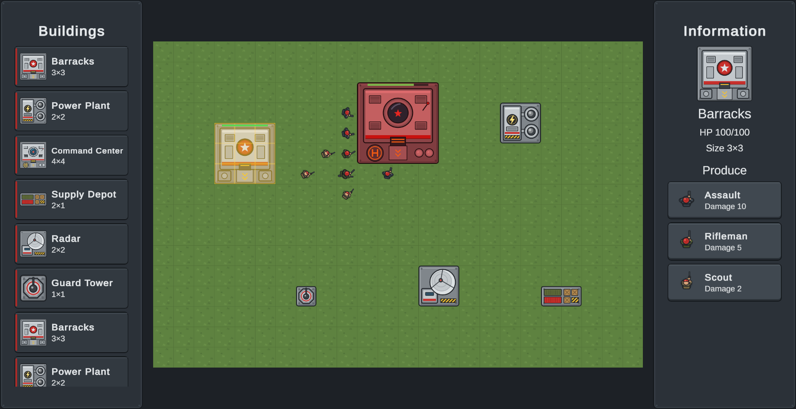

# Strategy Game Demo

A 2D real-time strategy prototype built for the Panteon "Strategy Game Demo" case in **Unity 6.3 LTS**
(Universal 2D / URP). Place buildings from an endlessly scrolling production menu, train soldiers from a
Barracks, move them around buildings with A\* and attack buildings or other soldiers.



**Windows build:** download `StrategyGameDemo-Windows.zip` from the
[v1.0.0 release](https://github.com/recepcankececi/PanteonStrategyDemo/releases/tag/v1.0.0), unzip it and run
`Strategy Game Demo.exe`. The window is resizable (minimum 1024×576).

## Controls

| Input | Action |
|---|---|
| Left-click a building in the **Production Menu** | Start placing it; a green / red preview follows the cursor |
| Left-click on the board while placing | Place the building (only on a free, in-bounds area) |
| **Shift** + left-click while placing | Place and keep placing the same building |
| Right-click or **Esc** while placing | Cancel placement |
| Left-click a building or soldier | Select it; the **Information Panel** shows it |
| Left-click a soldier type in the Information Panel | Produce that soldier on the selected Barracks' spawn point (the marked cell); it then walks to the nearest free cell. Greyed out while no free cell is left |
| Left-drag on the board | Box-select soldiers |
| Left-click an empty cell | Clear the selection |
| Right-click an empty cell (soldiers selected) | Move along the shortest path; a group spreads over nearby free cells |
| Right-click a building or another soldier (soldiers selected) | Attack it until it is destroyed |

There is no enemy faction: as the case allows, soldiers attack your own buildings and soldiers.

## Requirement checklist

| Case item | How it is met | Where |
|---|---|---|
| Unity 6.3 LTS, 2D | Unity 6000.3.10f1, Universal 2D (URP) template | `ProjectSettings/ProjectVersion.txt` |
| Playable Windows build | Built by `Tools > Build > Windows`, attached to the GitHub release | `Scripts/EditorTools/BuildScript.cs` |
| Several building types besides Barracks and Power Plant | Six buildings: Barracks 3×3, Power Plant 2×2, Command Center 4×4, Supply Depot 2×1, Radar 2×2, Guard Tower 1×1 | `ScriptableObjects/Buildings/` |
| Buildings placed at a user-chosen suitable spot; invalid placement shown | Preview turns red over occupied or off-board cells; placing there is refused | `BuildingPlacer`, `PlacementGhost` |
| Buildings have a name, image and dimensions | `BuildingDefinition` ScriptableObject: name, sprite, footprint, max HP | `Scripts/Data/BuildingDefinition.cs` |
| Unlimited production, no production time | Placing and producing are instant and unlimited while free cells remain | `BuildingPlacer.TryPlace`, `UnitProducer.TryProduce` |
| Information Panel shows the selected building; producers list their units | Image, name, HP, size; Barracks adds its three soldiers with image and damage | `Scripts/UI/InfoPanel.cs` |
| Only Barracks produce units; Power Plant has no production menu | Production list exists only when the definition has producible units | `BuildingDefinition.CanProduceUnits` |
| Soldiers: left-click select, right-click move via shortest path around buildings | A\* over the grid, buildings are walls | `Scripts/Core/Pathfinder.cs`, `Scripts/Gameplay/UnitMovement.cs` |
| Each Barracks has a spawn point | A marked cell beside the Barracks, chosen when it is placed (middle of the bottom side, else right, top, left) and kept for life. Soldiers always appear there and walk to the nearest free cell; no building and no stopping soldier may take it. A spot with no usable side is red | `SpawnSides`, `BuildingPlacer`, `UnitProducer` |
| 3 soldier types, HP 10; damage 10 / 5 / 2 | Soldier1 = **Assault** (damage 10, range 2), Soldier2 = **Rifleman** (5, range 3), Soldier3 = **Scout** (2, range 4); all HP 10, every shot draws a tracer | `ScriptableObjects/Units/` |
| Building HP: Barracks 100, Power Plant 50, others their own | 100, 50, Command Center 200, Supply Depot 60, Radar 80, Guard Tower 120 | `ScriptableObjects/Buildings/` |
| Right-click attacks a soldier or building | Selected soldiers chase the target, then hit it on an interval | `Scripts/Gameplay/UnitCombat.cs` |
| Destroyed at HP 0 | One despawn path frees cells, selection and attackers, returns the object to its pool | `Scripts/Gameplay/OccupantDespawner.cs` |
| Batching, SetPass calls < 20 | **9 SetPass** measured in a 102-soldier stress scene (Game view stats, Frame Debugger) | see *Rendering* below |
| Works across aspect ratios; resizable window | Camera fits the board between the side panels; Canvas Scaler *Scale With Screen Size*; resizable window | `BoardCameraFitter`, `CameraFraming`, `MinimumWindowSize` |
| Production Menu with infinite scroll | Rows wrap around endlessly; a fixed set of rows is recycled | `Scripts/UI/ProductionMenu.cs` |
| Infinite scroll uses object pooling | Rows come from `ObjectPool<T>`; scrolling never instantiates | `Scripts/Core/ObjectPool.cs`, `InfiniteScrollMath.cs` |
| Layout: Production Menu left, board centre, Information right | Three-panel Canvas, board framed between them | `Scenes/Main.unity` |
| Pathfinding with A\* | Octile heuristic, binary-heap open list, no diagonal corner cutting | `Pathfinder`, `PathNodeHeap` |
| All edge cases considered | Every case per system with the test that proves it, plus the few limits accepted on purpose | [`Docs/EdgeCases.md`](Docs/EdgeCases.md) |

Paths above are relative to `Assets/_Project/`. Every logic rule in the table has EditMode tests (678 in total); how each edge case is handled, and which test proves it, is listed in [Docs/EdgeCases.md](Docs/EdgeCases.md).

## Architecture

```
Assets/_Project/Scripts/
  Core/          plain C#, no Unity scene dependencies: grid, A*, reservations, object pool, scroll math
  Data/          ScriptableObject definitions: buildings, units, catalog, grid, effects
  Gameplay/      board rules and views: placement, selection, production, movement, combat, despawn
  UI/            Production Menu, Information Panel
  App/           composition root (GameBootstrap) and input polling
  EditorTools/   build script, generated-art import rules (editor only)
```

- **One assembly per module.** `Core` and `Data` reference nothing; `Gameplay` uses them; `UI` sits on top of
  `Gameplay`; only `App` sees everything. A test fails if a reference points the wrong way.
- **Composition root.** `GameBootstrap` is the only place that creates services and wires them; read top to bottom
  it is the start-up order. No singletons, no `Find*`, no static state; modules talk through constructor-injected
  services, interfaces (`IDamageable`, `IDespawnable`, `IBuildingFactory`, ...) and C# events.
- **Rules apart from views.** Placement, selection, movement and combat are plain C# classes ticked by thin
  `MonoBehaviour` drivers, so they are tested without a scene.
- **Data-driven.** Names, sprites, footprints, HP, damage, range, attack interval, speed and the grid size live in
  ScriptableObjects. A new building is a new asset added to `BuildingCatalog`; no code changes.
- **A\*.** 8-directional grid search with an octile heuristic and a binary heap; buildings are walls, soldiers are
  not (each soldier reserves the cell it will stop on instead, and each Barracks reserves its spawn cell for its
  whole life). An unreachable goal ends at the closest reachable cell. Buffers are reused, so a search allocates nothing after warm-up.
- **Pooling.** Production Menu rows, Information Panel rows, soldiers, buildings, selection markers and combat
  effects all come from `ObjectPool<T>` and reset their state on release. The Production Menu keeps only the rows
  that fit on screen plus one, moves the row that scrolls out to the other end and rebinds it.
- **Rendering.** All board sprites share one SpriteAtlas and one unlit material; nothing touches
  `renderer.material` at runtime (colour changes use `SpriteRenderer.color`). The whole board draws in a single SRP
  Batcher pass, so a stress scene with 102 soldiers measures **9 SetPass calls** in the Game view. The ground is a
  single tiled sprite outside the atlas.
- **No per-frame garbage.** Gameplay code allocates nothing per frame after warm-up; EditMode tests assert this with
  Unity's `GC.Alloc` recorder.

## Opening the project

1. Install **Unity 6000.3.10f1** (6.3 LTS) with Windows Build Support.
2. Open the repository folder in Unity Hub and open `Assets/_Project/Scenes/Main.unity`.
3. Press Play.

**Build:** `Tools > Build > Windows` writes the player to `Builds/Windows/`. Batchmode:

```
Unity.exe -batchmode -quit -projectPath . -executeMethod StrategyDemo.EditorTools.BuildScript.BuildWindows -logFile Builds/build.log
```

**Tests:** `Window > General > Test Runner > EditMode > Run All` (assembly `StrategyDemo.Tests.EditMode`, 678 tests).

## Art

Every sprite was **created for this project** by `Tools/ArtGen`, a small Node generator that writes the sprites as SVG
in code and renders them to PNG (`@resvg/resvg-js`, MPL-2.0, a development tool only; nothing of it ships with the
game). There is no third-party art. Building sprites are exactly footprint × 64 px with a centred pivot. See
`Tools/ArtGen/README.md` to regenerate them.

## Development process

The project was developed with **Claude Code** as an AI pair programmer, which the case allows. I set the rules it
works under: the requirement checklist (`.claude/requirements.md`), coding and scene standards (`CLAUDE.md`), hooks
that block hand-editing Unity-serialized files and unsafe git commands, a milestone workflow with mandatory tests,
and an independent reviewer agent run at the end of every milestone. Every architecture decision was written down,
reviewed and approved by me before implementation, and every gameplay and visual result was checked by me in the
editor. The `.claude/` folder and `CLAUDE.md` are kept in the repository for transparency.
